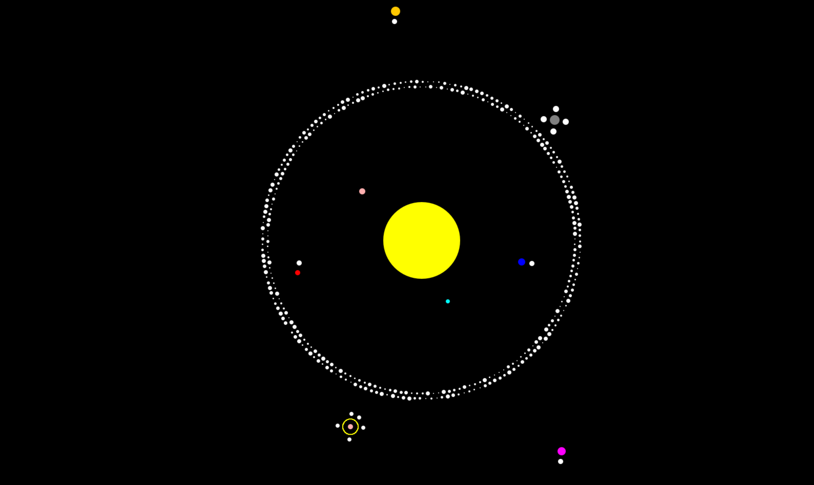

# Solar System Model

A desktop Java application that animates a two-dimensional solar system using Swing and AWT. A stationary yellow Sun sits at the center while eight planets orbit it, moons orbit their planets, and small particles form an asteroid belt and Saturn's rings.



The project demonstrates object-oriented modeling, inheritance, encapsulation, and polar-coordinate rendering. It is a visual model with deliberately simplified sizes, distances, and motion.

## Table of Contents

- [Features](#features)
- [Requirements](#requirements)
- [Install Java](#install-java)
  - [Windows](#windows)
  - [macOS](#macos)
  - [Linux](#linux)
  - [Verify The Installation](#verify-the-installation)
- [Download The Project](#download-the-project)
- [Compile and Run](#compile-and-run)
- [Using The Application](#using-the-application)
- [Objects In The Model](#objects-in-the-model)
- [How It Works](#how-it-works)
- [Project Files](#project-files)
- [Run From IDE](#run-from-an-ide)
- [API Documentation](#api-documentation)
- [Troubleshooting](#troubleshooting)
- [Credits](#credits)

## Features

- Eight orbiting planets: Mercury, Venus, Earth, Mars, Jupiter, Saturn, Uranus, and Neptune.
- Thirteen white moons distributed across six planets.
- Two bands of 179 white asteroids each, between Mars and Jupiter, rotating in opposite directions.
- Saturn's rings represented by 178 small yellow particles, reusing the moon class.
- A black background and colored circular bodies rendered with antialiasing.
- Continuous animation with a 20 ms delay between frame updates.
- Included Java source and generated Javadoc.

## Requirements

| Item | Requirement |
| --- | --- |
| Java | A Java Development Kit (JDK), version 17 or newer |
| Desktop | Windows, macOS, or Linux with a graphical desktop and Java desktop support |
| Display | Enough screen space for the application's initial 1700 x 1000 pixel window |
| Terminal | PowerShell, Command Prompt, or a macOS/Linux terminal |
| Internet | Needed to download the JDK and project; the application itself runs offline |
| Git | Optional; only needed for the clone download method |
| IDE | Optional; compilation and execution work from a terminal |

Install a **JDK**, rather than just a Java Runtime Environment (JRE), because building requires `javac`. JDK 17 is the minimum because `Main.java` uses the two-argument `Random.nextInt(origin, bound)` API available through Java 17's random generator interface. See the [Java 17 API reference](https://docs.oracle.com/en/java/javase/17/docs/api/java.base/java/util/Random.html).

Swing, AWT, and the utility classes used here are part of the JDK. No Maven, Gradle, JavaFX, external JARs, texture packs, image downloads, or API keys are required. The PNG and JavaScript files in the repository support the generated documentation; the animation draws its own shapes.

## Install Java

One option is [Eclipse Temurin](https://adoptium.net/temurin/releases/), a distribution of OpenJDK. Select **version 21**, **JDK**, your operating system, and your processor architecture. An existing full JDK 17 or newer can also be used.

### Windows

1. Open the [Temurin downloads page](https://adoptium.net/temurin/releases/).
2. Select Windows, version 21, JDK, and the architecture matching your computer. For a typical 64-bit Intel or AMD PC, select x64.
3. Download the `.msi` installer for x64 Windows and open it.
4. Follow the installer prompts. Keep the option to add Java to `PATH` enabled; enable the option to set `JAVA_HOME` if offered.
5. Complete installation, then close and reopen your terminal so it receives the updated environment.
6. Continue to [Verify The Installation](#verify-the-installation).

For other architectures and installation formats, follow the provider's instructions. See the official [Windows installation guide](https://adoptium.net/installation/windows/).

### macOS

1. Open the [Temurin downloads page](https://adoptium.net/temurin/releases/).
2. Select macOS, version 21, and JDK. Choose aarch64 for Apple Silicon or x64 for an Intel Mac.
3. Download and open the `.pkg` installer.
4. Follow the installation prompts and enter an administrator password if requested.
5. Open a new Terminal window and continue to [Verify The Installation](#verify-the-installation).

See the official [macOS installation guide](https://adoptium.net/installation/macOS/).

### Linux

Use a full desktop JDK rather than a headless-only runtime. For a download-based installation:

1. Open the [Temurin downloads page](https://adoptium.net/temurin/releases/).
2. Select Linux, version 21, JDK, and the architecture matching your computer. Choose the build appropriate to your distribution, including its C library if multiple variants are offered.
3. Download the `.tar.gz` archive.
4. In your file manager, extract the archive into a directory you own, such as `~/Applications/java`.
5. Locate the extracted JDK directory. It should contain a `bin` directory with `java` and `javac`.
6. In your terminal, replace the example path below with the actual extracted JDK directory:

   ```sh
   export JAVA_HOME="$HOME/Applications/java/your-extracted-jdk-directory"
   export PATH="$JAVA_HOME/bin:$PATH"
   ```

7. To keep these settings for future sessions, add the two lines with your actual path to your shell startup file, such as `~/.bashrc` for Bash, then open a new terminal.
8. Continue to [Verify The Installation](#verify-the-installation).

If you prefer system packages, follow the official [Linux package installation guide](https://adoptium.net/installation/linux/) for your distribution, choosing a JDK version of at least 17.

### Verify The Installation

Run both commands:

```sh
java --version
javac --version
```

Both should report version 17 or newer, ideally the same major version. Version 21 output may begin with `openjdk version "21..."` and `javac 21...`; patch numbers vary.

If either command is unavailable or reports an older version, resolve that using [Troubleshooting](#troubleshooting) before compiling.

## Download The Project

Choose either method.

**Option 1: Download a ZIP (no Git required)**

1. Open the [Solar System Model repository](https://github.com/sahasatyaki/Solar-System-Model).
2. Select **Code**, then **Download ZIP**.
3. Extract the ZIP completely using your file manager. Do not run commands from inside the archive.
4. Open the extracted directory containing `Main.java`, `SolarSystem.java`, and this README. Its name may include a branch suffix, such as `Solar-System-Model-main`.
5. Open a terminal in that directory, or enter `cd` followed by its path in quotes:

   ```text
   cd "path/to/extracted/Solar-System-Model-main"
   ```

Replace the example path with your actual directory.

**Option 2: Clone with Git**

1. If necessary, install Git from the [official Git downloads page](https://git-scm.com/downloads/) using the instructions for your operating system.
2. Open a new terminal and check it with `git --version`.
3. Run:

   ```sh
   git clone https://github.com/sahasatyaki/Solar-System-Model.git
   cd Solar-System-Model
   ```

Both methods provide the same source files. A public repository can be downloaded without an SSH key.

## Compile and Run

Run the following commands from the repository root, the directory containing all eight `.java` files. These commands work in PowerShell, Command Prompt, and typical macOS/Linux shells.

1. Create a directory for compiled classes on your first build:

   ```sh
   mkdir out
   ```

   If `out` already exists, skip this step.

2. Compile all source files together:

   ```sh
   javac --release 17 -d out Main.java SolarSystem.java Fixed_Sun.java Planets.java Planet_speed.java Solar_Object.java Moons_for_Planets.java Asteroid_belt.java
   ```

   A successful compilation normally prints nothing. The `--release 17` option generates classes compatible with Java 17 and newer. The `-d out` option places build output in `out`, which is excluded by `.gitignore`.

3. Start the application:

   ```sh
   java -cp out Main
   ```

4. A window titled **The Solar System** should open and begin animating automatically. Keep the terminal open while it runs.
5. Close the application window to exit. You can also press `Ctrl+C` in the terminal that launched it.

For later launches, run `java -cp out Main` from the repository root again. Recompilation is only needed if the source changes or the compiled output is missing. No packaged executable or runnable JAR is required.

## Using The Application

The animation starts immediately and runs until you close it. There are no keyboard shortcuts, menus, pause buttons, zoom controls, or runtime settings. No command-line arguments are needed or interpreted.

The yellow Sun is centered in the initial 1700 x 1000 window. All planets start at orbital angle zero, so they initially line up on the same side of the Sun before spreading out at different speeds. Moons and ring particles move around their parent planets. Asteroid sizes are randomly selected at startup, so their appearance can vary between runs.

Use the following table to identify the planets by color and orbital distance. Labels and orbit trails are not drawn in the window.

## Objects In The Model

Distances and diameters below are drawing units in pixels; the angle increment is degrees per animation iteration, rather than a physical orbital speed.

| Planet | Color | Distance from Sun | Diameter | Angle increment | Moons |
| --- | --- | --- | --- | --- | --- |
| Mercury | Cyan | 130 | 8 | 1.9 | 0 |
| Venus | Pink | 150 | 12 | 1.8 | 0 |
| Earth | Blue | 200 | 14 | 1.7 | 1 |
| Mars | Red | 250 | 10 | 1.6 | 1 |
| Jupiter | Gray | 350 | 19 | 1.5 | 4 |
| Saturn | Pink | 390 | 10 | 1.4 | 5 |
| Uranus | Orange | 450 | 18 | 1.3 | 1 |
| Neptune | Magenta | 495 | 16 | 1.2 | 1 |

The Sun has a diameter of 150. The asteroid bands have radii of 300 and 310, with angle increments of -0.2 and 0.2 respectively. Their particles have diameters from 2 through 8. Saturn's 178 ring particles have a radius of 15, diameter 2, and angle increment of 1.5.

## How It Works

`Main.main()` constructs the window and celestial objects, then repeatedly updates their angles, queues their shapes, and calls `finishedDrawing()`.

The two inheritance relationships are:

```text
Planet_speed (abstract)
|-- Planets
`-- Asteroid_belt

Solar_Object
`-- Moons_for_Planets
```

`Planet_speed` defines the abstract `updateSpeed()` method. Its two subclasses implement it by adding an angular increment to the current angle. Despite the method name, this updates orbital position, not the stored speed. `Solar_Object` holds shared moon properties, and `Moons_for_Planets.updateposition()` advances a moon's local angle. Ring particles use that same class and behavior.

`SolarSystem` converts polar coordinates into drawing coordinates. With angle measured in degrees, the positioning logic is equivalent to:

```text
x = centerX + distance * sin(angleInRadians) - diameter / 2
y = centerY + distance * cos(angleInRadians) - diameter / 2
```

`drawSolarObject()` uses the window's configured center. `drawSolarObjectAbout()` first locates a supplied orbital center, then offsets the object around it. This lets moons follow moving planets. Zero degrees points downward in this screen-coordinate convention.

`finishedDrawing()` requests a repaint, sleeps for 20 ms, and clears the queued shapes for the next iteration. This produces a nominal upper rate near 50 updates per second before processing and rendering overhead; it does not guarantee a fixed frame rate. The renderer uses an offscreen image and antialiasing to draw the circular bodies.

## Project Files

| File or directory | Purpose |
| --- | --- |
| `Main.java` | Entry point; creates all bodies, defines their initial parameters, and runs the animation loop. |
| `SolarSystem.java` | Swing window and AWT renderer, color conversion, polar-coordinate drawing, and frame updates. Includes a private `SolarObject` class for queued drawing data. |
| `Fixed_Sun.java` | Stores the Sun's diameter, yellow color, and stationary center coordinates. |
| `Planets.java` | Stores planet properties and advances orbital angles; extends `Planet_speed`. |
| `Planet_speed.java` | Abstract base class declaring `updateSpeed()` for planets and asteroids. |
| `Solar_Object.java` | Base class holding distance, angular velocity, angle, diameter, and color for moons. Distinct from the renderer's private `SolarObject`. |
| `Moons_for_Planets.java` | Extends `Solar_Object`; stores a parent planet reference and updates local orbital angles. Also represents Saturn's ring particles. |
| `Asteroid_belt.java` | Represents individual asteroids with a Sun reference and orbital properties; extends `Planet_speed`. |
| `docs/` | Included generated API Documentation; start at `docs/index.html`. |
| `index-files/`, `resources/`, `script-dir/` | Additional generated documentation index files and supporting assets. |
| `.gitignore` | Excludes compiled classes, build directories, and local IDE configuration. |
| `out/` | Local compiled output created by the build instructions; not part of the source distribution. |

## Run From IDE

An IDE is optional. If you already use one with Java support:

1. Download or clone the project and install a JDK as described above.
2. Open the repository directory as a Java project or a project from existing sources.
3. Select JDK 17 or newer as the project SDK and language level.
4. Mark the repository root, containing `Main.java`, as the Java source directory if it is not detected automatically. The classes use the default package, so there is no `src/main/java` package tree to configure.
5. Exclude generated documentation and build output from source roots if your IDE asks.
6. Open `Main.java` and run its `public static void main(String[] args)` method, or create an Application run configuration with main class `Main`.
7. Use the IDE's Stop action or close the window to end the program.

No Maven or Gradle project import is needed. The terminal build is also useful for checking an IDE configuration problem.

## API Documentation

Open `docs/index.html` from the downloaded repository in a web browser. GitHub's file view displays HTML source; download the repository and open the file locally to browse the rendered documentation.

Useful starting pages:

- [All classes](docs/allclasses-index.html)
- [Application entry point](docs/Main.html)
- [Window and rendering API](docs/SolarSystem.html)
- [Planet model](docs/Planets.html)
- [Moon model](docs/Moons_for_Planets.html)
- [Asteroid model](docs/Asteroid_belt.html)

The existing documentation can be browsed without installing Java. If you want to generate a fresh copy from the source, use a separate local output directory:

```sh
javadoc -d out/api Main.java SolarSystem.java Fixed_Sun.java Planets.java Planet_speed.java Solar_Object.java Moons_for_Planets.java Asteroid_belt.java
```

Then open `out/api/index.html`. Documentation warnings about missing comments or tags may be reported by newer JDKs.

## Troubleshooting

| Problem | What to do |
| --- | --- |
| `java` or `javac` is not recognized / command not found | Install a full JDK and reopen the terminal. Ensure its `bin` directory is on `PATH`. A JRE alone does not provide `javac`. |
| `Random.nextInt` argument error, or `release version 17 not supported` | The selected compiler is too old. Check `javac -version` and select JDK 17 or newer. |
| `UnsupportedClassVersionError` | The runtime is older than the compiled classes. Check both version commands, use Java 17 or newer, and rebuild with the documented `--release 17` command. |
| `Could not find or load main class Main` | Run from the repository root after compiling successfully. Use exactly `java -cp out Main`; the main class is case-sensitive and has no package prefix. |
| Compiler cannot find a source file or another class | Confirm you extracted the ZIP, entered the directory containing `Main.java`, and included all eight files in the compilation command. |
| `HeadlessException` or a display connection error | Run in a graphical desktop session with a full JDK. A headless server, plain SSH terminal, or WSL session without GUI support cannot display the Swing window. |
| The window or outer planets are cut off | Use a display with room for the initial 1700 x 1000 window. The outermost orbits approach its vertical edges, and resizing does not recalculate the model's configured center. |
| Movement is uneven or differs between computers | Motion advances per loop iteration. Rendering time, desktop scaling, and machine load affect timing. |
| The terminal stays busy after launch | This is expected: the animation loop runs until you close the window or press `Ctrl+C`. |

To inspect which Java installation is selected, use `where.exe java` and `where.exe javac` on Windows, or `command -v java` and `command -v javac` on macOS/Linux. If multiple installations appear, ensure the intended JDK's `bin` directory comes first on `PATH`.

## Credits

The model and application classes are authored by Satyaki Saha. The `SolarSystem.java` drawing helper is credited to Dr. Joe Finney in its source header. Generated documentation includes supporting third-party assets and notices under `docs/legal/`.